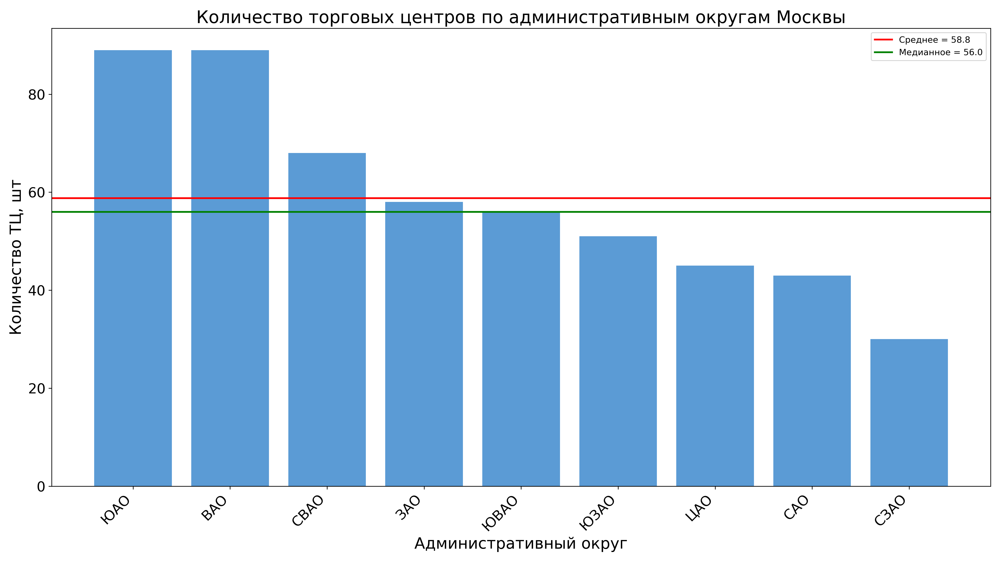
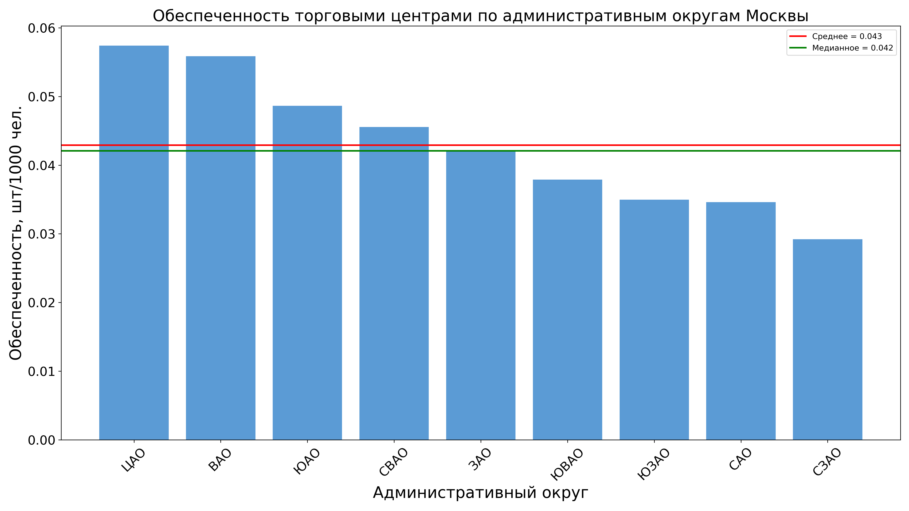
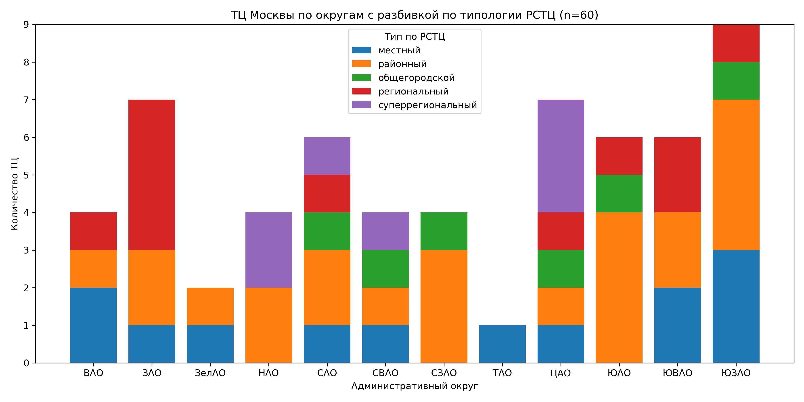
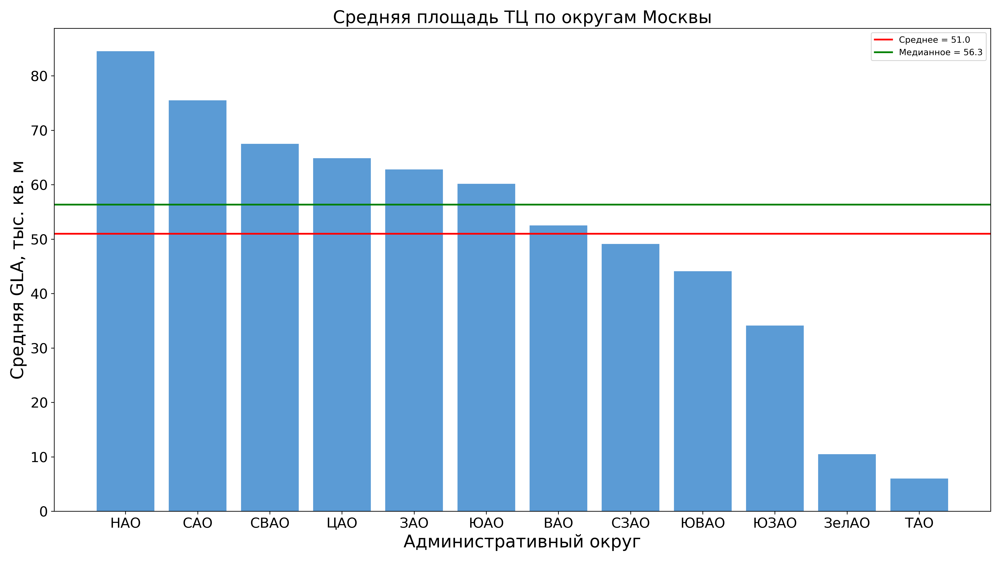

# Дифференциация торговых центров по административным округам Москвы

## О проекте

В качестве темы для проекта я взял часть моей курсовой работы, связанной с изучением дифференциации и динамики структуры торговых центров по административным округам Москвы. Одной из промежуточных задач курсовой является изучение обеспеченности ТЦ по округам. На данный момент при работе с существующими источниками по теме, я не нашел описанных выше данных и их визуализаций в виде графиков. Соответственно, цель проекта: визуализировать и проанализировать данные по обеспеченности ТЦ по количеству и по площади с помощью языка Python и встроенных библиотек. Полученные по итогам проекта результаты и материалы будут использоваться мной далее при написании курсовой.

## Задачи проекта

1. Спарсить и подготовить датасет по ТЦ (название, координаты, площадь)
2. С помощью Python создать следующие графики:
    - Количество ТЦ по округам (общее количество и по типу торговый центр/универмаг
    - Обеспеченность ТЦ по округам
    - Распределение ТЦ по типологии по округам
    - Средняя площадь ТЦ по округам
3. Проанализировать графики и сформировать краткие выводы по ним

## Данные

В качестве основного датасета был использован csv-файл с данными о торговых центрах Москвы. В нем перечислены: названия ТЦ, координаты, адрес (при наличии), принадлежность к АО. Данные были получены через парсинг OpenStreetMap с помощью API Overpass.

Дополнительные данные:
- Датасет с более подробной информацией по выборке из 60 торговых центров (также данные по площади и году постройки ТЦ) - скомпилирован из отчетов по недвижимости и сайтов ТЦ с помощью ИИ.
- Данные о численности населения автономных округов (Мосгорстат, 2024)

## Ограничения данных

Прежде чем строить графики и диаграммы, стоит упомянуть ограничения, которые накладывают сами данные.
Во-первых, удалось спарсить лишь данные по округам в пределах МКАД. С одной стороны, это интересно наблюдение, что в OSM данные по ТЦ в ЗелАО и ТиНАО не размечены (теги ставятся на отдельные магазины). С другой стороны, отсутствие трех округов нарушает целостность исследования. Для дальнейшей работы с курсовой либо необходимо найти данные по округам из других источников, либо немного менять логику и структуру исследования
Во-вторых нужно упомянуть, что в основном датасете представлены, строго говоря, не все торговые центры. Мелкие пассажи, дома быта и т.д. не отмечены на OSM и не включаются при парсинге. Другое дело, что как в этом проекте, так и в курсовой работе, нас не интересует мелкие объекты торговли, внимание уделяется в основном крупным и средним ТЦ.

## Инструменты

Помимо инструментов и библиотек описанных в лекциях курса мной были использованы следующие инструменты:
1. метод csv.DictReader - считывает строки из csv и представляет их в виде словаря, где ключ - название столбца, значения - ячейки столбца
2. pandas.merge - сопоставляет строки массива по заданным столбцам
3. Counter - позволяет быстро считать пары значений в строке
4. Kimi AI, для консультации по возникающим ошибкам в коде

## Описание графиков

На первом графике видно, что больше всего торговых центров расположено в ЮАО и ВАО (по 89 объектов), а меньше всего - в СЗАО. Среднее значение составляет 58,8, медиана - 56 торговых центров. В целом можно сказать что больше ТЦ сконцентрировано на востоке/юго-востоке Москвы.

Картина почти обратная первому графику: максимум ТЦ в ЦАО и ВАО (~0,055–0,057 шт/1000 чел.), минимум - у СЗАО (~0,03). То есть округ-лидер по абсолютному числу (ЮАО) по обеспеченности лишь в середине, из-за того что в ЮАО просто больше населения. СЗАО находится на последнем месте по обоим показателям.

Является, наверное, самым информативный для курсовой. САО и СВАО - самые разнообразные округа по типам. ЦАО выделяется концентрацией суперрегиональных (Атриум, Афимолл) - подтверждает гипотезу курсовой о тяготении крупных форматов к центру. ЗАО - почти все региональные. Малые округа выборки (ТАО - 1 объект, ЗелАО - 2) малоинформативны.

GLA - Gross Leasable Area - полезная площадь здания, которая сдается в аренду арендаторам и приносит доход.
НАО лидирует (~84 тыс. м²) - эффект крупных ТЦ вдоль МКАД, далее САО (~75) и СВАО (~68). Минимум - ТАО (~5) и ЗелАО (~11): там представлены только мелкие объекты.

## Выводы

По итогам анализа графиков можно сделать несколько выводов:
1. Графики имеют существенные ограничения, связанные с источником данных - OSM. В данных OSM нет целостной информации по ТЦ в ЗелАО и ТиНАО.
2. Распределение ТЦ по округам крайне неравномерно: лидеры (ЮАО и ВАО) превышают аутсайдера (СЗАО) почти в три раза.
3. Структура крупных ТЦ по типологии РСТЦ подтверждает центростремительную модель: ЦАО концентрирует суперрегиональные форматы, в то время как периферийные территории в большей мере представлены преимущественно районными центрами.
## Структура репозитория

- `SM_mineyev_project` - папка с датасетами и блокнотом с кодом
- Папка `images` - сохраненные графики
- `README.md` - этот md-файл с описанием проекта

